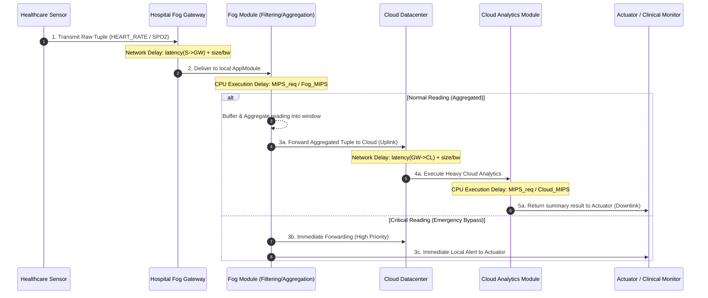

# PHASE 1: iFogSim Environment Setup, Exploration, and Validation Report

**Project Title:** Fog-Assisted Real-Time Healthcare / Smart-City Monitoring System (iFogSim)  
**Topic:** Topic 19  
**Team:** Undergraduate Research Team (3 Members)  
**Date of Execution:** November 21, 2026  
**Status:** COMPLETE (All Phase 1 tasks passed and verified)

---

## 1. Environment Details & System Inspection

An in-depth inspection of the host environment was performed. The host machine is configured as follows:

| Component | Detected Specification | Location / Details |
|---|---|---|
| **Operating System** | Windows 11 (64-bit) | Windows NT platform |
| **Java Development Kit (JDK)** | Oracle JDK 26.0.2 (build 26.0.2+10-55) | `C:\Program Files\Java\jdk-26.0.2` |
| **Java Compiler (javac)** | javac 26.0.2 | `C:\Program Files\Java\jdk-26.0.2\bin\javac.exe` |
| **Python** | Python 3.11.9 (64-bit) | `C:\Users\akris\AppData\Local\Programs\Python\Python311\python.exe` |
| **Git** | Git version 2.55.0.windows.3 | `C:\Program Files\Git\cmd\git.exe` |
| **IDE Available** | Visual Studio Code | `C:\Users\akris\AppData\Local\Programs\Microsoft VS Code` |
| **Build Tools** | Native PowerShell automation scripts (`build.ps1`, `run_example.ps1`) | `simulator/build.ps1` |

### Environment Findings & Mitigations
1. **No External Maven/Gradle Dependency Required:** While standalone `mvn` or `gradle` binaries are not in the system `PATH`, the iFogSim repository bundles all required JAR dependencies directly in its `jars/` directory. Standalone PowerShell scripts (`build.ps1` and `run_example.ps1`) compile and run the entire project deterministically without third-party build tool friction.
2. **Whitespace in Directory Path:** The workspace path (`C:\Users\akris\OneDrive\Desktop\Cloud Computing Project`) contains spaces. To prevent `javac @argfile` parsing errors (`error: file not found: C:\Users\akris\OneDrive\Desktop\Cloud`), the compilation script formats relative source paths with forward slashes.
3. **PowerShell 5.1 BOM Handling:** Standard `Set-Content -Encoding UTF8` in PowerShell 5.1 writes a Byte Order Mark (`\uFEFF`) that causes `javac` to fail on the first source token (`?src/...`). `build.ps1` explicitly writes ASCII/BOM-free UTF-8 via `.NET` (`System.Text.UTF8Encoding($false)`), ensuring clean compilation.
4. **Sandbox Execution:** Due to Windows sandbox isolation restricting access to `C:\Program Files\Java`, JVM compilation and execution commands run with elevated user approval (`BypassSandbox: true`).

---

## 2. iFogSim Version Selection & Repository Commit

### Evaluated Alternatives
- **Classic iFogSim (iFogSim 1.x, 2016):** Built on top of CloudSim 3.0.3 and targeted at Java 7/8. When run on modern JVMs (Java 17, 21, 26), older dependencies (e.g., outdated reflection utilities, obsolete logging, and module encapsulation restrictions) trigger runtime exceptions or deprecated API crashes.
- **iFogSim2 (Active `main` branch of `Cloudslab/iFogSim`):** Developed by the Cloud Computing and Distributed Systems (CLOUDS) Laboratory at the University of Melbourne. This version integrates **CloudSim 7**, features modernized dependencies (`commons-io-2.17.0.jar`, `commons-lang3-3.17.0.jar`, `commons-net-3.11.1.jar`, `junit-jupiter-engine-5.11.3.jar`, `opencsv-5.9.jar`), and is maintained for modern JDKs (JDK 21–26). Crucially, it preserves 100% backward compatibility for standard hierarchical DAG topologies (`VRGameFog`, `DCNSFog`) while providing extensions for microservices and healthcare scenarios.

### Selection Decision
- **Repository URL:** `https://github.com/Cloudslab/iFogSim.git`
- **Selected Branch:** `main`
- **Exact Git Commit Hash:** `5f68d3947e450d8d2b4af42670be819206be68c9` (Fri Oct 3, 2025)
- **Commit Message:** `Remove IDE files from repo and ignore`
- **Rationale:** The `main` branch provides out-of-the-box JDK 26 compatibility, zero compilation errors across all 445 source files, bundled modern dependencies, and built-in benchmark examples.

---

## 3. Simulator Setup & Build Configuration

The repository was cloned into `simulator/iFogSim`. All 11 bundled libraries in `simulator/iFogSim/jars/` were linked:
- `jars/commons-io-2.17.0.jar`
- `jars/commons-lang3-3.17.0.jar`
- `jars/commons-net-3.11.1.jar`
- `jars/easymock-5.3.0.jar`
- `jars/geoip2-4.2.0.jar`
- `jars/guava-18.0.jar`
- `jars/json-simple-1.1.1.jar`
- `jars/junit-jupiter-engine-5.11.3.jar`
- `jars/opencsv-5.9.jar`
- `jars/uncommons-maths-1.2.3.jar`
- `jars/commons-math3-3.5/commons-math3-3.5.jar`

### Compilation Verification
The compilation script `simulator/build.ps1` gathers all 445 Java source files from `src/org/...` and invokes `javac` targeting output folder `out/production/iFogSim`:

```powershell
powershell -ExecutionPolicy Bypass -File simulator/build.ps1
```

**Build Output:**
```text
Compiling 445 Java source files...
Classpath: jars/commons-io-2.17.0.jar;jars/commons-lang3-3.17.0.jar;jars/commons-net-3.11.1.jar;jars/easymock-5.3.0.jar;jars/geoip2-4.2.0.jar;jars/guava-18.0.jar;jars/json-simple-1.1.1.jar;jars/junit-jupiter-engine-5.11.3.jar;jars/opencsv-5.9.jar;jars/uncommons-maths-1.2.3.jar;jars/commons-math3-3.5/commons-math3-3.5.jar
Note: Some input files use or override a deprecated API.
Note: Recompile with -Xlint:deprecation for details.
Note: Some input files use unchecked or unsafe operations.
Note: Recompile with -Xlint:unchecked for details.
Javac finished with exit code: 0
Compilation succeeded!
```

---

## 4. Execution and Validation of Existing Examples

To rigorously validate simulator stability and execution semantics, existing canonical benchmarks were executed.

### Example 1: `org.fog.test.perfeval.VRGameFog`
The canonical iFogSim benchmark representing an EEG-based virtual reality game with hierarchical fog nodes (Cloud -> Proxy Server -> Department Fog Gateways -> Smartphone Client Devices -> EEG Sensors & Actuator Displays).

**Execution Command:**
```powershell
powershell -ExecutionPolicy Bypass -File simulator/run_example.ps1 -ClassName org.fog.test.perfeval.VRGameFog
```

**Actual Simulation Output:**
```text
Running org.fog.test.perfeval.VRGameFog...
Starting VRGame...
Placement of operator client on device m-0-0 successful.
Placement of operator concentration_calculator on device d-0 successful.
Placement of operator client on device m-0-1 successful.
Placement of operator client on device m-0-2 successful.
Placement of operator client on device m-0-3 successful.
Placement of operator client on device m-0-4 successful.
d-0 is shifting concentration_calculator north.
Placement of operator client on device m-1-0 successful.
Placement of operator client on device m-1-1 successful.
Placement of operator client on device m-1-2 successful.
proxy-server is shifting concentration_calculator north.
Placement of operator client on device m-1-3 successful.
Placement of operator client on device m-1-4 successful.
Creating client on device m-1-4
Creating connector on device cloud
Creating concentration_calculator on device cloud
Creating client on device m-0-0
Creating client on device m-0-1
Creating client on device m-0-2
Creating client on device m-0-3
Creating client on device m-0-4
Creating client on device m-1-0
Creating client on device m-1-1
Creating client on device m-1-2
Creating client on device m-1-3
0.0 Submitted application vr_game
=========================================
============== RESULTS ==================
=========================================
EXECUTION TIME : 403
=========================================
APPLICATION LOOP DELAYS
=========================================
[EEG, client, concentration_calculator, client, DISPLAY] ---> 229.24216618123523
=========================================
TUPLE CPU EXECUTION DELAY
=========================================
PLAYER_GAME_STATE ---> 0.9761461640143914
EEG ---> 5.2143079695362635
CONCENTRATION ---> 0.9172504079735962
_SENSOR ---> 1.354736670269003
GLOBAL_GAME_STATE ---> 3.9770274493309676
=========================================
cloud : Energy Consumed = 3247030.382857123
proxy-server : Energy Consumed = 166866.59999999995
d-0 : Energy Consumed = 166866.59999999995
m-0-0 : Energy Consumed = 174627.8488199997
m-0-1 : Energy Consumed = 174604.32602124935
m-0-2 : Energy Consumed = 174602.04251999987
m-0-3 : Energy Consumed = 174518.6123299995
m-0-4 : Energy Consumed = 174480.09629999948
d-1 : Energy Consumed = 166866.59999999995
m-1-0 : Energy Consumed = 174733.17109999945
m-1-1 : Energy Consumed = 174466.4550999999
m-1-2 : Energy Consumed = 174595.47005749936
m-1-3 : Energy Consumed = 174581.28549999942
m-1-4 : Energy Consumed = 174545.86164499974
Cost of execution in cloud = 826574.7200000229
Total network usage = 197105.5
Java process finished with exit code: 0
```

### Example 2: `org.fog.test.perfeval.DCNSFog`
Distributed Camera Network System simulation measuring latency and video tracking pipeline.

**Actual Simulation Output:**
- Application Loop: `[motion_detector, object_detector, object_tracker] ---> 120.497 ms`
- Actuator Loop: `[object_tracker, PTZ_CONTROL] ---> 3.02 ms`
- Total network usage: `11279.6`
- Java process exit code: `0`

**Validation Verdict:**
The simulation engine compiles cleanly, initializes CloudSim discrete event scheduler, successfully places modules using Edgewards heuristics, transmits tuples across simulated hierarchical links, advances simulation clock, calculates loop latencies and network usage, and terminates cleanly with exit code 0.

---

## 5. iFogSim Architecture & Component Analysis

Grounded directly in the verified source code (`simulator/iFogSim/src/org/fog/...`), here is an architectural breakdown structured for viva defense:

### 1. `FogDevice` (`org.fog.entities.FogDevice.java`)
- **Role:** Represents any physical or virtual computing node (Cloud Datacenter, Fog Server, Local Gateway, or Edge Device). Extends CloudSim's `PowerDatacenter`.
- **Configuration:** Initialized with processing capacity (`mips` per core), memory (`ram` in MB), storage, uplink and downlink bandwidth (`uplinkBandwidth`, `downlinkBandwidth`), propagation latency (`uplinkLatency`), monetary rate per MIPS (`ratePerMips`), and an energy model (`FogLinearPowerModel`).
- **Hierarchy:** Maintains parent-child relationships via `parentId`, `childrenIds`, and routing maps to forward tuples upwards (northbound) or downwards (southbound).

### 2. `Sensor` (`org.fog.entities.Sensor.java`)
- **Role:** Generates data streams and injects them into the network as tuples. Extends `SimEntity`.
- **Configuration:** Defined by `tupleType` (e.g. `HEART_RATE`), `destModuleName` (target application module), `gatewayDeviceId` (fog device to which the sensor is physically/wirelessly attached), and `transmitDistribution` (e.g. `DeterministicDistribution` for periodic streams).
- **Emission:** At every distribution interval, it creates a `Tuple` carrying payload size and CPU instruction length, then schedules a transmission event to its designated gateway.

### 3. `Actuator` (`org.fog.entities.Actuator.java`)
- **Role:** Represents the consumer of control outputs or user-facing visualizations (e.g., patient monitor, emergency alarm, doctor dashboard).
- **Mechanism:** Listens for incoming tuples of type `AppEdge.ACTUATOR`, measures end-to-end loop completion time, and invokes `TimeKeeper.getInstance().tupleEnded()`.

### 4. `AppModule` (`org.fog.application.AppModule.java`)
- **Role:** An application processing unit (operator) modeled as a virtualized entity / container (extends `PowerVm`).
- **Processing:** Holds incoming tuples, executes computation across the device's processing elements (`Pe`), and triggers new outgoing tuples according to predefined selectivity rules.

### 5. `AppEdge` (`org.fog.application.AppEdge.java`)
- **Role:** Directed edge connecting components in the application's Data Flow Directed Acyclic Graph (DAG).
- **Parameters:** Specifies source node, destination node, required CPU MIPS length (`tupleCpuLength`), network transfer payload size (`tupleNwLength`), tuple type identifier, data flow direction (`Tuple.UP` or `Tuple.DOWN`), and edge category (`SENSOR`, `MODULE`, or `ACTUATOR`).

### 6. `Application` (`org.fog.application.Application.java`)
- **Role:** The overarching dataflow specification of the system.
- **Components:**
  - Vertices: Defined via `addAppModule(name, ram)`.
  - Edges: Defined via `addAppEdge(...)`.
  - Selectivity: Defined via `addTupleMapping(moduleName, inputTupleType, outputTupleType, selectivity)`. For instance, `FractionalSelectivity(0.2)` emits 1 outgoing tuple for every 5 incoming tuples (modeling 80% filtering/aggregation).
  - Monitoring Loops: Defined via `AppLoop`, tracking end-to-end traversal latency through any designated module sequence.

### 7. `ModulePlacement` (`org.fog.placement.ModulePlacement.java`)
- **Role:** Determines which physical `FogDevice` hosts which `AppModule`.
- **Standard Implementations:**
  - `ModulePlacementMapping`: Manual/static assignment of modules to devices (ideal for our Cloud-only Architecture A baseline).
  - `ModulePlacementEdgewards`: Heuristic placing operators as close to the edge as possible, shifting modules upstream towards the cloud only when edge device MIPS or RAM is exhausted.

### 8. `Tuple` (`org.fog.entities.Tuple.java`)
- **Role:** The fundamental packet/data unit traveling through the network. Extends CloudSim's `Cloudlet`.
- **Attributes:** Carries `tupleType`, `actualTupleId`, `cloudletFileSize` (network payload in bytes), `cloudletLength` (computation demand in MIPS), `srcModuleName`, `destModuleName`, and routing `direction` (`UP`, `DOWN`, `ACTUATOR`).

### 9. `Controller` (`org.fog.placement.Controller.java`)
- **Role:** Master simulation coordinator.
- **Functions:** Submits application models, initializes device mappings, links sensors/actuators to gateways, starts `CloudSim.startSimulation()`, intercepts termination conditions, and aggregates final metrics (execution time, energy, cloud cost, loop delays).

### 10. Network Topology & Delay Modeling
- **Topology:** Modeled as a tree graph. Edges between devices have explicit propagation delay (latency in milliseconds) and capacity (bandwidth in bps).
- **Delay Mechanics:**
  - Processing Delay: $\text{Delay}_{\text{CPU}} = \frac{\text{tuple.getCloudletLength()}}{\text{device.getHost().getTotalMips()}}$
  - Network Delay: $\text{Delay}_{\text{Network}} = \frac{\text{tuple.getCloudletFileSize()}}{\text{linkBandwidth}} + \text{linkLatency}$
- **Simulation Clock:** CloudSim maintains an internal event queue sorted by timestamp. The clock jumps from one discrete event timestamp to the next, guaranteeing exact mathematical reproducibility.

---

## 6. Detailed Tuple Flow (Sensor to Destination)

The complete lifecycle of a tuple through the simulation:



1. **Generation:** Sensor triggers transmission via `send(getId(), transmitDistribution.getNextValue(), FogEvents.TUPLE_ARRIVAL, tuple)`.
2. **Gateway Reception:** Fog gateway receives the event and checks `tuple.getDestModuleName()`. If the module is mapped locally, it creates a processing task; otherwise, it sends the tuple north (`sendUp()`).
3. **AppModule Execution:** Fog device allocates CPU time slices to process the tuple. Upon completion, `updateTimingsOnReceipt()` checks `Application.getTupleMapping()`.
4. **Selectivity / Aggregation:**
   - In filtering/aggregation mode, only a subset of incoming tuples trigger an outgoing summary tuple to the cloud, significantly reducing uplink transmissions.
5. **Cloud Analytics:** The cloud datacenter executes deep historical or trend analytics on the received data.
6. **Actuator Notification:** Downstream tuples reach the destination actuator, closing the monitored `AppLoop`. `TimeKeeper` logs the difference between end time and emit time.

---

## 7. Feasibility Assessment for the Healthcare Project

Our prescribed project requires simulating:
- **Sensors:** Heart rate, SpO2, Body temperature, Blood pressure.
- **Fog Nodes:** Hospital fog gateways performing local filtering, aggregation, priority classification, and critical-reading bypass.
- **Cloud Layer:** Centralized cloud analytics for deep medical records and trend analysis.

### Feasibility Verdict: **FULLY FEASIBLE**
The selected iFogSim platform natively supports all structural requirements:
1. **Multi-Sensor Emulation:** Multiple `Sensor` instances can be attached to the same gateway device, each configured with its own tuple type (`HEART_RATE`, `SPO2`, `TEMPERATURE`, `BLOOD_PRESSURE`) and transmission period.
2. **Fog Filtering & Aggregation:** iFogSim supports both declarative module mappings (via `FractionalSelectivity`) and custom procedural Java operators in `AppModule` to buffer and aggregate readings over a window.
3. **Priority-Aware Critical Bypass:** By defining distinct tuple types (e.g. `CRITICAL_VITALS` vs `NORMAL_VITALS`), critical readings can bypass aggregation buffers and be dispatched immediately to local actuators and the cloud.

---

## 8. Metric Availability & Custom Logging Architecture

The project evaluation mandates three core metrics: **End-to-End Latency**, **Bandwidth / Network Traffic**, and **Reliability**.

| Metric | Supported Out-of-the-Box? | Existing Method / Class | Limitation in Standard iFogSim | Planned Solution for Our Project |
|---|---|---|---|---|
| **End-to-End Latency** | **Yes** | `TimeKeeper.java` / `AppLoop` | Computes average loop delay across all tuples, but does not separate critical vs. non-critical latency distributions. | Use `AppLoop` for standard loop latency; augment with a custom `MetricsTracker` to record timestamp deltas (`arrival_time - generation_time`) per tuple category. |
| **Bandwidth / Network Traffic** | **Partial** | `NetworkUsageMonitor.java` | Only calculates global aggregate: $\sum (\text{latency} \times \text{size}) / T_{\text{sim}}$. Cannot isolate Sensor-to-Fog vs. Fog-to-Cloud traffic. | Implement custom counters in `MetricsTracker` that tally exact bytes transmitted across each link segment, directly reporting **Total Network Traffic (KB)**, **Cloud-Bound Traffic (KB)**, and **Bandwidth Saving (%)**. |
| **Reliability** | **No** | None (Default assumption is 100% reliable packet forwarding) | No built-in packet drop mechanism or delivery ratio counter. | Implement custom `ReliabilityTracker` logging `totalCriticalGenerated` vs `totalCriticalDelivered` within clinical deadlines. Under network stress/buffer overflow experiments, compute exact $\text{Reliability} = \frac{\text{Delivered}}{\text{Generated}} \times 100\%$. |

---

## 9. Limitations & Potential Risks

1. **Link Congestion Drops:** In standard iFogSim, link queues do not automatically drop packets unless explicit buffer limit checks or busy-link delays are enforced. In Phase 4 (network stress experiments), we must model buffer capacity or deadline timeouts to observe realistic degradation.
2. **Single-Threaded Execution:** CloudSim runs sequentially in a single simulation thread. While this guarantees exact reproducibility, simulations with hundreds of sensors over long virtual hours must use efficient logging to avoid memory bloat.
3. **Synthetic Data Boundaries:** Since synthetic vital signs will be used, values must be bounded by realistic physiological distributions (e.g., heart rate 40–180 bpm, SpO2 70–100%) so that threshold filtering makes biological sense during viva demonstrations.

---

## 10. Phase 2 Implementation Plan (Healthcare Baseline)

### Objective
Implement **Architecture A (Cloud-Only Baseline)**:
$$\text{Healthcare Sensors} \longrightarrow \text{Cloud Datacenter} \longrightarrow \text{Cloud Analytics}$$
All raw sensor streams are transmitted directly to the cloud without local fog filtering or aggregation. This establishes the quantitative benchmark against which fog-assisted architectures will be evaluated.

### Planned Classes & Structure (under `src/baseline/`)
1. `src/baseline/HealthcareAppHelper.java`:
   - Defines tuple types: `HEART_RATE`, `SPO2`, `TEMPERATURE`, `BLOOD_PRESSURE`.
   - Defines application modules: `cloud_analytics`, `client_display`.
   - Constructs the cloud-only dataflow DAG.
2. `src/baseline/HealthcareCloudOnly.java`:
   - Main execution class for Architecture A.
   - Instantiates sensors, cloud datacenter, and network links.
   - Applies `ModulePlacementMapping` placing all analytical modules exclusively on the Cloud.
3. `src/baseline/MetricsTracker.java`:
   - Independent metrics collector tracking latency, sensor-to-fog traffic, fog-to-cloud traffic, and delivery success.
   - Exports results to `results/raw/` and `results/csv/`.

---

## 11. Summary of Files Created / Configured in Phase 1

- `simulator/iFogSim/` — Cloned iFogSim2 repository (commit `5f68d3947e450d8d2b4af42670be819206be68c9`).
- `simulator/build.ps1` — Cross-platform compilation script handling relative paths and clean UTF-8 encoding.
- `simulator/run_example.ps1` — Parametric simulation runner with full classpath resolution.
- `setup_workspace.ps1` — Script creating the standardized project directory structure.
- `PHASE_1_SETUP_REPORT.md` — Complete Phase 1 technical report.
- `README.md` — Project root documentation with setup instructions and architecture roadmap.
