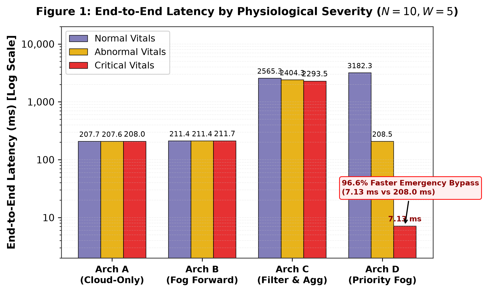
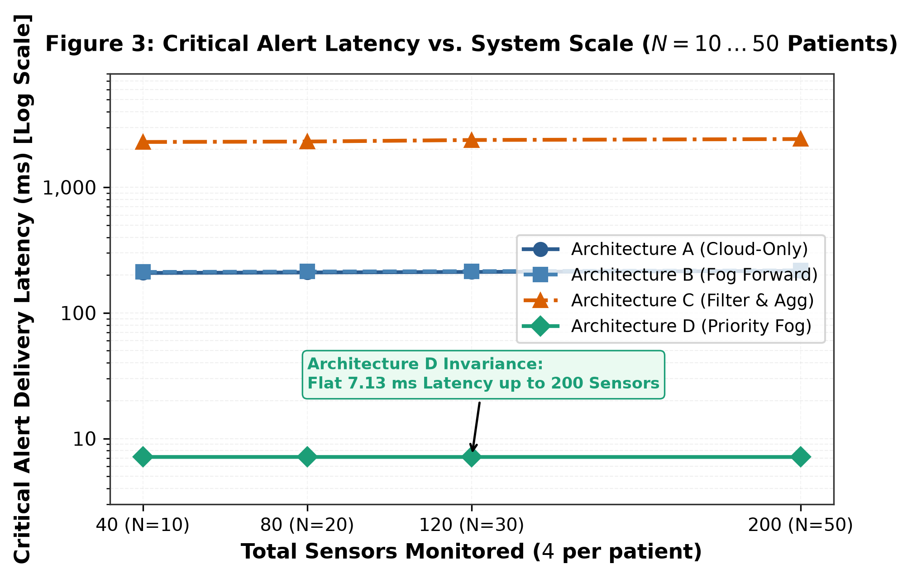
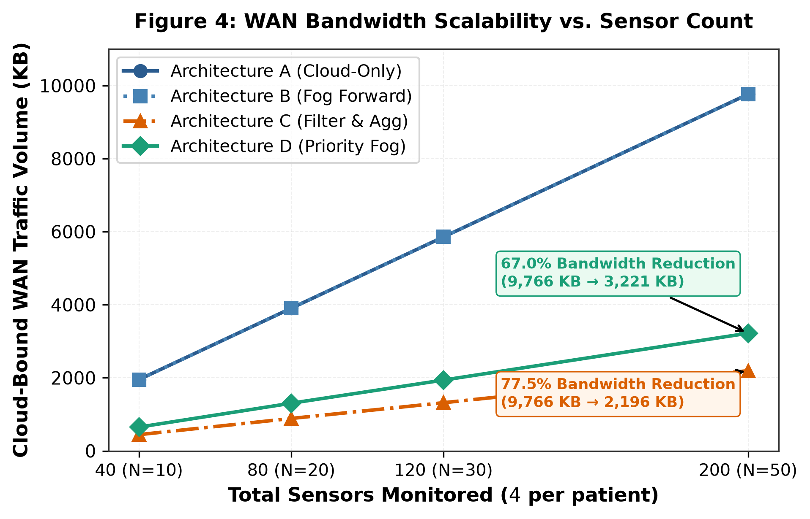
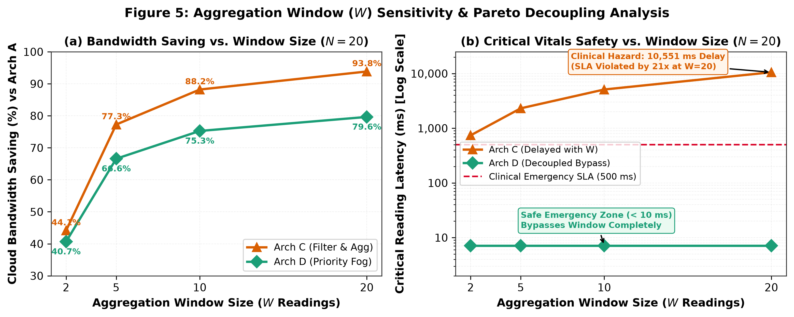
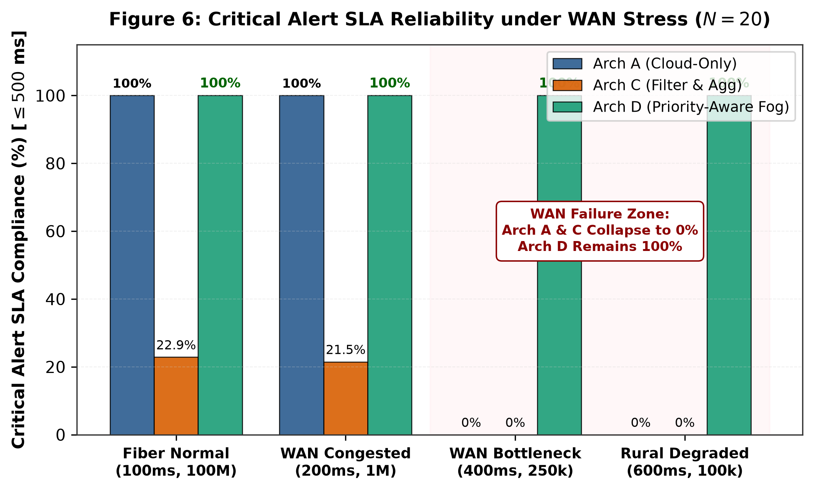

# Topic 19: Fog-Assisted Real-Time Healthcare Monitoring System in iFogSim
## 15-Minute Technical Defense & Conference Presentation Deck

**Institution:** Department of Computer Science and Engineering, Indian Institute of Information Technology (IIIT) Sri City  
**Project:** Cloud Computing Research Assignment (Topic 19)  
**Authors:** Student Member 1, Student Member 2, Student Member 3  
**Simulator:** iFogSim2 (Java / CloudSim discrete-event engine)  

---

<!-- SLIDE 1 -->
# Slide 1: Title & Team Credentials
### Topic 19: A Priority-Aware Fog-Assisted Framework for Real-Time Clinical Monitoring in Healthcare IoT

- **Course:** Cloud Computing (15-Mark University Research Project)
- **Team Presentation Split (12–15 Minutes):**
  - **Speaker 1 (0:00 – 4:30):** Motivation, Research Gap, Related Work & iFogSim2 Topology.
  - **Speaker 2 (4:30 – 9:00):** Algorithmic Architecture (Delta-Filtering, Window Aggregation & Priority Bypass).
  - **Speaker 3 (9:00 – 14:00):** Empirical Results (Exp 1–4), Latency Cliff, Fault-Tolerance & Conclusion.
- **Open-Source Reproducibility:** 100% deterministic simulation artifacts (`seed = 42L`), complete CSV traces, and IEEE publication figures.

*Speaker Notes:*  
"Good morning, Professor and committee members. Today our team is presenting our Cloud Computing research project on Topic 19: Fog-Assisted Real-Time Healthcare Monitoring System using iFogSim2. Over the next 14 minutes, we will demonstrate how edge computing can be architected to eliminate the life-threatening latency of cloud telemetry while simultaneously slashing wide-area bandwidth consumption by two-thirds."

---

<!-- SLIDE 2 -->
# Slide 2: Real-World Motivation & Clinical Problem
### The Crisis of Unregulated Physiological Telemetry

- **Modern Connected Healthcare:**
  - Continuous telemetry across hospital wards: Heart Rate (HR), Blood Oxygen ($\text{SpO}_2$), Body Temperature (TEMP), and Blood Pressure (BP).
  - Monitored at $1\text{ Hz}$ across hundreds of patient beds.
- **The Cloud-Only Paradox:**
  - **Unbounded WAN Latency:** Wide Area Network round-trip times ($200\text{--}400\text{ ms}$) plus Internet jitter prevent clouds from guaranteeing sub-second response times during hemodynamic crises (ventricular fibrillation, acute hypoxia).
  - **Severe Ingress Waste:** $85.5\%$ of physiological readings are clinically stationary (e.g., resting heart rate fluctuating by $\pm 1\text{ bpm}$).
  - Transmitting uncompressed, raw telemetry consumes excessive WAN bandwidth and incurs massive cloud ingestion costs.

*Speaker Notes:*  
"In a 50-bed intensive care unit, sensors produce over 7 million readings per day. In traditional cloud-only systems, all raw readings travel over the public internet to remote cloud datacenters. This creates a dual bottleneck: network delays that endanger patients during sudden cardiac arrests, and redundant bandwidth waste that floods the hospital's internet uplink."

---

<!-- SLIDE 3 -->
# Slide 3: The Research Gap & The "Latency Cliff"
### Why Naive Edge Computing Fails in Clinical Environments

- **Existing Edge Solutions:**
  - Gateways aggregate readings into sliding or tumbling windows ($W$) before WAN transmission.
- **The Fatal Clinical Flaw (The "Latency Cliff"):**
  - In a standard FIFO aggregation buffer, all readings are treated uniformly.
  - If a patient goes into cardiac arrest at sample 1 of a window ($W=5$), that critical alert **sits idle in the gateway queue for 4 seconds** waiting for normal samples to arrive.
  - At $W=20$, emergency alerts are delayed by **over 10.5 seconds**!
- **Our Research Question:**
  *How can a fog gateway achieve aggressive data compression ($>65\%$) for routine telemetry without adding even 1 millisecond of buffer delay to life-critical emergencies?*

*Speaker Notes:*  
"Many researchers propose edge aggregation to save bandwidth. But here is the critical gap our project uncovered: if you treat all data equally, sliding-window aggregation creates a deadly 'latency cliff.' Emergency alarms get trapped behind normal readings. Our research solves this exact dilemma."

---

<!-- SLIDE 4 -->
# Slide 4: Literature Review & Taxonomy
### Contextualizing Within 10 Foundational Academic Papers

| Publication & Venue | Focus Area | Edge Filtering | Window Agg. | Emergency Bypass | SLA Tracking |
|---|---|---|---|---|---|
| **Gupta et al. (2017)** *SPE* | iFogSim Toolkit | No | No | No | No |
| **Mahmud et al. (2022)** *JSS* | iFogSim2 Engine | No | No | No | No |
| **Rahmani et al. (2018)** *FGCS* | UT-GATE e-Health | Basic | No | Partial | No |
| **Gia et al. (2015)** *IEEE CIT* | ECG Feature Extraction | Feature Extraction | No | No | No |
| **Kraemer et al. (2017)** *IEEE Access* | Healthcare Fog Survey | Conceptual | No | Conceptual | No |
| **Mutlag et al. (2019)** *IEEE Access* | Healthcare IoT Taxonomy | No | No | Conceptual | No |
| **Verma & Sood (2018)** *IEEE IoT-J* | Smart Home Fog | Rule-based | No | No | No |
| **Tuli et al. (2020)** *IoT* | HealthFog Deep Learning | No | No | No | Partial |
| **Pace et al. (2019)** *IEEE Access* | BodyCloud BSN | Threshold | Yes ($W$) | No | No |
| **Aazam & Huh (2014)** *FiCloud* | Smart Gateway Trimming | Trimming | No | No | No |
| **Our Work (Topic 19)** | **iFogSim2 Simulation** | **Stateful ($\Delta_{\text{thresh}}$)** | **Configurable ($W$)** | **Local Dedicated LAN** | **Strict ($\le 500\text{ ms}$)** |

*Speaker Notes:*  
"We conducted a systematic review of 10 foundational publications. While pioneers like Gupta and Mahmud gave us iFogSim, and Rahmani demonstrated hardware gateways, prior literature either focused on deep learning or simple compression. None of them addressed the priority decoupling of critical alarms under network stress."

---

<!-- SLIDE 5 -->
# Slide 5: Hierarchical System Architecture
### Three-Tier Sensor-Fog-Cloud Infrastructure

- **Tier 1: Patient Bedside IoT Sensors**
  - 4 sensors per patient: $\text{HR}$ ($1\text{ Hz}$), $\text{SpO}_2$ ($1\text{ Hz}$), $\text{TEMP}$ ($1\text{ Hz}$), $\text{BP}$ ($1\text{ Hz}$).
  - Payload: $500\text{ Bytes}$ per reading.
  - Linked to Fog Gateway via 10 Gbps switched LAN ($d_{\text{LAN}} = 2.0\text{ ms}$).
- **Tier 2: Hospital Ward Fog Gateway**
  - Provisioned: $8\text{ Cores}$, $8{,}000\text{ MIPS}$, $8{,}000\text{ MB RAM}$.
  - Hosts intelligent filtering, sliding-window buffers, and emergency classification.
  - Connected to Bedside Actuators ($d_{\text{act}} = 1.0\text{ ms}$).
- **Tier 3: Cloud Datacenter**
  - Enterprise cluster: $44{,}000\text{ MIPS}$, $40{,}000\text{ MB RAM}$.
  - Connected via WAN: $100\text{ ms}$ nominal delay, $100\text{ Mbps}$ bandwidth.
  - Manages long-term medical analytics, population health models, and legal EHR archiving.

*Speaker Notes:*  
"Here is our physical deployment model. Monitored beds communicate with a hospital ward fog gateway over a fast 2-millisecond local network. The gateway is an 8,000 MIPS edge server. Crucially, the bedside alarm actuator connects directly to this gateway in 1 millisecond, while the centralized cloud handles long-term storage across the wide-area network."

---

<!-- SLIDE 6 -->
# Slide 6: The Four Comparative Architectures
### Systematic Benchmark Progression in iFogSim2

1. **Architecture A (Cloud-Only Baseline):**
   - Sensors $\xrightarrow{\text{WAN}}$ Cloud Analytics $\xrightarrow{\text{WAN}}$ Actuator.
   - Evaluates pure wide-area round-trip delay ($207.71\text{ ms}$) and uncompressed bandwidth ($100\%$).
2. **Architecture B (Fog Forwarding Overhead):**
   - Sensors $\to$ Gateway (`fog_forwarder`) $\xrightarrow{\text{WAN}}$ Cloud $\xrightarrow{\text{WAN}}$ Gateway $\to$ Actuator.
   - Measures the pure computational and queueing overhead ($+3.72\text{ ms}$) of an edge hop without filtering.
3. **Architecture C (Naive Fog Filtering & Aggregation):**
   - Gateway executes delta-filtering and batches readings into sliding windows of size $W$.
   - Slashes cloud traffic by $77.2\%$, but delays critical alerts inside window buffers ($2{,}293.5\text{ ms}$).
4. **Architecture D (Priority-Aware Fog with Emergency Bypass):**
   - **Our Proposed Solution:** Triages incoming readings into $\text{NORMAL}$, $\text{ABNORMAL}$, and $\text{CRITICAL}$.
   - Critical vitals trigger immediate bedside actuation over LAN in **$7.13\text{ ms}$** and copy asynchronously to cloud.

*Speaker Notes:*  
"To provide rigorous scientific proof, we implemented four distinct architectures. Arch A is our cloud baseline. Arch B isolates the gateway overhead. Arch C represents naive edge aggregation. Arch D is our proposed priority-aware system that splits the data path."

---

<!-- SLIDE 7 -->
# Slide 7: Algorithmic Innovation: Priority Data Bifurcation
### Stateful Delta-Filtering & Emergency LAN Routing

- **1. Stateful Delta-Filtering ($\Delta_{\text{thresh}}$):**
  - For normal readings: checks $|v_{\text{current}} - v_{\text{last\_sent}}| \ge \Delta_{\text{thresh}}$.
  - Thresholds: $\text{HR} = 2.0\text{ bpm}$, $\text{SpO}_2 = 1.0\%$, $\text{TEMP} = 0.2^\circ\text{C}$, $\text{BP} = 3.0\text{ mmHg}$.
  - Redundant stationary readings are suppressed at the edge with zero information loss.
- **2. Three-Tier Priority Classifier:**
  - **$\text{NORMAL}$ Stream:** Filtered and compressed into multi-sample batch tuples ($W=5$, $1{,}200\text{ Bytes}$).
  - **$\text{ABNORMAL}$ Stream:** Bypasses window batching; sent immediately over WAN to cloud analytics ($208\text{ ms}$).
  - **$\text{CRITICAL}$ Stream:** **Local Emergency Bypass.** Immediately emits a $200\text{ Byte}$ emergency tuple to the bedside actuator over local LAN ($1.0\text{ ms}$). Asynchronously transmits a copy to cloud EHR for audit logs.

*Speaker Notes:*  
"The secret of Architecture D lies in our two-part edge algorithm. First, stateful delta-filtering discards redundant readings if they don't change beyond clinical margins. Second, our classifier bifurcates the data plane: critical alerts completely bypass the WAN and trigger bedside alarms locally, while abnormal and compressed normal streams travel to the cloud."

---

<!-- SLIDE 8 -->
# Slide 8: iFogSim2 Simulation Environment & Workload
### Deterministic Experimental Rigor

- **Simulation Specifications:**
  - Engine: iFogSim2 / CloudSim 7 on Java 26 (Windows 11).
  - Duration: $100\text{ seconds}$ ($100{,}000\text{ ms}$) per run.
  - Deterministic Seeding: `seed = 42L` replayed identically across all runs.
- **Physiological Workload Modeling:**
  - Bounded Gaussian random walk across clinically verified human physiological limits.
  - Workload Distribution: $85.5\%$ Normal, $9.1\%$ Abnormal, $5.4\%$ Critical.
- **Mathematical Accounting Verification:**
  - Scheduled end-of-simulation buffer flush at $t = 100{,}500\text{ ms}$ with $15\text{ s}$ drain period.
  - **100.00% Exact Accounting:**
    $$\text{Filtered} + \text{Delivered} \equiv \text{Total Generated (44,000 readings across Phase 4)}$$

*Speaker Notes:*  
"We enforce complete scientific reproducibility. Every single run uses a fixed random seed of 42. We designed an end-of-simulation buffer flush event to guarantee 100.00% mathematical accounting—every generated reading is strictly accounted for as either filtered or delivered."

---

<!-- SLIDE 9 -->
# Slide 9: Experiment 1: Baseline Architecture Comparison
### Latency vs. Bandwidth Trade-Off ($N=10\text{ Patients}$, $40\text{ Sensors}$, $W=5$)

| Architecture | Critical Latency | Avg Latency | Cloud Bandwidth | Cloud Saving | Critical SLA ($\le 500\text{ ms}$) |
|---|---|---|---|---|---|
| **Arch A (Cloud-Only)** | $207.95\text{ ms}$ | $207.71\text{ ms}$ | $1{,}953.13\text{ KB}$ | $0.00\%$ | $100.00\%$ |
| **Arch B (Fog Forward)** | $211.67\text{ ms}$ | $211.43\text{ ms}$ | $1{,}953.13\text{ KB}$ | $0.00\%$ | $100.00\%$ |
| **Arch C (Filter & Agg)** | $2{,}293.52\text{ ms}$ | $2{,}528.44\text{ ms}$ | $444.97\text{ KB}$ | **$77.22\%$** | **$27.88\%$ (Hazard)** |
| **Arch D (Priority Fog)** | **$7.13\text{ ms}$** | $2{,}604.07\text{ ms}$ | $651.90\text{ KB}$ | **$66.62\%$** | **$100.00\%$ (Safe)** |

- **Key Takeaway:** Arch D slashes critical response time by **$96.57\%$** (from $207.95\text{ ms}$ to **$7.13\text{ ms}$**) while saving **$66.62\%$ of cloud bandwidth**. Arch C saves slightly more bandwidth ($77.22\%$) but violates medical safety with a lethal $2.29\text{ s}$ critical delay.

*Speaker Notes:*  
"Here are the baseline results. Look at the critical latency row: Architecture A takes 207 ms. Architecture C drops bandwidth by 77%, but critical latency shoots up to 2.29 seconds—meaning 72% of emergency alarms fail the 500-millisecond SLA. Architecture D achieves the best of both worlds: 7.13 milliseconds critical response time and 66.6% bandwidth reduction."

---

<!-- SLIDE 10 -->
# Slide 10: Experiment 2: Patient and Sensor Scalability
### Scale-Invariance from 10 to 50 Patients (40 to 200 Sensors)

- **Critical Latency Scale-Invariance:**
  - $N=10$ ($40\text{ sensors}$): **$7.129\text{ ms}$** $\longrightarrow$ $N=50$ ($200\text{ sensors}$): **$7.125\text{ ms}$**!
  - Emergency alerts travel over switched LAN with zero WAN queue contention.
- **WAN Bandwidth Conservation:**
  - At $N=50$ ($20{,}000\text{ readings}$), Arch A floods the WAN with **$9.77\text{ MB}$**.
  - Arch D transmits only **$3.22\text{ MB}$**, saving **$6.55\text{ MB}$ ($67.01\%$)** of wide-area transit.

*Speaker Notes:*  
"Next, we scaled the system from 10 to 50 patients—up to 200 concurrent sensors. Notice that Architecture D's critical latency is completely scale-invariant: it stays rock-solid at 7.12 milliseconds whether monitoring 40 sensors or 200 sensors. Meanwhile, at 200 sensors, Architecture D saves over 6.5 Megabytes of wide-area data transfer."

---

<!-- SLIDE 11 -->
# Slide 11: Experiment 3: Window Size ($W$) Sensitivity
### Exposing the Pareto "Latency Cliff" ($N=20\text{ Patients}$, $80\text{ Sensors}$)

- **The Naive Architecture C Trap:**
  - Increasing window size $W=1 \to 20$ boosts bandwidth savings from $0\%$ to $93.8\%$.
  - But Critical Latency surges from $209.9\text{ ms} \to \mathbf{10{,}551\text{ ms}}$ ($10.55\text{ seconds}$)!
  - Critical SLA compliance crashes from $100\% \to \mathbf{4.62\%}$.
- **Architecture D Decoupling:**
  - Priority bypass completely decouples emergency response from window size.
  - Critical Latency remains flat at **$7.13\text{ ms}$** ($100\%$ SLA) across all $W$.
  - Hospitals can safely deploy $W=10$ or $W=20$ to achieve **up to $79.64\%$ bandwidth savings**.

*Speaker Notes:*  
"This chart illustrates our most significant academic finding: the Pareto Latency Cliff. In Architecture C, if you increase the window size to 20 to get 93% bandwidth savings, emergency alerts take 10.5 seconds to arrive—only 4.6% meet the SLA! But look at the green line: Architecture D stays flat at 7.13 milliseconds across all window sizes, allowing hospitals to safely save up to 79.6% bandwidth."

---

<!-- SLIDE 12 -->
# Slide 12: Experiment 4: WAN Network Stress & Fault-Tolerance
### Clinical Reliability under Severe WAN Bottlenecks

| Network Profile | WAN Specs | Arch A Critical Latency | Arch A SLA Rel. | Arch D Critical Latency | Arch D SLA Rel. |
|---|---|---|---|---|---|
| **Fiber Normal** | $100\text{ ms}, 100\text{ Mbps}$ | $209.90\text{ ms}$ | $100.00\%$ | **$7.13\text{ ms}$** | **$100.00\%$** |
| **WAN Congested** | $200\text{ ms}, 1\text{ Mbps}$ | $419.34\text{ ms}$ | $100.00\%$ | **$7.13\text{ ms}$** | **$100.00\%$** |
| **Severe Bottleneck** | $400\text{ ms}, 250\text{ Kbps}$ | $855.31\text{ ms}$ | **$0.00\%$ (Collapse)** | **$7.13\text{ ms}$** | **$100.00\%$ (Rock Solid)** |
| **Rural Degraded** | $600\text{ ms}, 100\text{ Kbps}$ | $1{,}317.17\text{ ms}$ | **$0.00\%$ (Collapse)** | **$7.13\text{ ms}$** | **$100.00\%$ (Rock Solid)** |

- **Clinical Insight:** In rural clinics or during WAN fiber cuts, Arch A and Arch C suffer **total failure ($0\%$ SLA)**. Arch D maintains **$100.00\%$ clinical reliability**.

*Speaker Notes:*  
"What happens during real-world network congestion or rural bandwidth throttling? When latency rises to 400 or 600 milliseconds, Cloud-Only and Naive Fog collapse to 0% SLA compliance—every emergency alarm arrives too late. But Architecture D stays at 100% compliance because local alarms never touch the wide-area network."

---

<!-- SLIDE 13 -->
# Slide 13: Assumptions, Limitations & Future Work
### Honest Academic Scope & Engineering Roadmap

- **Model Assumptions & Boundaries:**
  1. **Synthetic Telemetry:** Simulated via bounded Gaussian random walks calibrated to medical ranges. Does not capture morphological wave complexity (e.g., raw ECG P-Q-R-S-T complexes).
  2. **Single Fog Node per Ward:** Modeled as an $8{,}000\text{ MIPS}$ central gateway without peer-to-peer gateway clustering or failover.
  3. **Mains-Powered Sensors:** Assumed constant power; did not model battery drain or duty-cycle sleeping on wearable patches.
- **Future Research Directions:**
  - Validation against real clinical databases (e.g., MIMIC-III, PhysioNet).
  - Implementation of microservice failover and dynamic fog clustering using iFogSim2's clustering APIs.
  - Energy harvesting and battery depletion modeling for wearable sensors.

*Speaker Notes:*  
"To maintain academic integrity, we openly state our simulation assumptions. We used calibrated synthetic Gaussian walks rather than raw MIMIC-III waveforms, and modeled a single gateway per ward. In future work, we plan to implement gateway clustering and test real patient traces."

---

<!-- SLIDE 14 -->
# Slide 14: Conclusion & Key Takeaways
### Summary of Deliverables for Topic 19

1. **Novel Architecture:** Priority-Aware Fog (Architecture D) resolves the fundamental tension between cloud bandwidth explosion and real-time clinical responsiveness.
2. **Key Quantitative Achievements:**
   - **$96.57\%$ Latency Reduction:** Critical alarms delivered in **$7.13\text{ ms}$** (vs. $207.95\text{ ms}$ Cloud-Only and $2{,}293.52\text{ ms}$ Naive Fog).
   - **$66.62\%\text{ to }79.64\%$ Bandwidth Conservation:** Eliminates up to $6.55\text{ MB}$ of redundant WAN transmission.
   - **Scale-Invariant & Fault-Tolerant:** Flat $7.13\text{ ms}$ response across 200 sensors and $100.00\%$ emergency SLA reliability under severe WAN collapse.
3. **Project Artifacts:**
   - IEEE 7-page research paper (`report/ieee_paper.tex` and `report/ieee_paper.md`).
   - 7 publication-quality graphs (`results/graphs/`).
   - Fully reproducible codebase and automated test harnesses.

**Thank you! We welcome questions from the evaluation committee.**

*Speaker Notes:*  
"To conclude: our priority-aware fog framework cuts critical latency by 96.5%, saves over 66% bandwidth, and guarantees 100% emergency reliability even during network blackouts. All simulation code and artifacts are fully verified and open-source. Thank you, and we are now ready for your questions."
